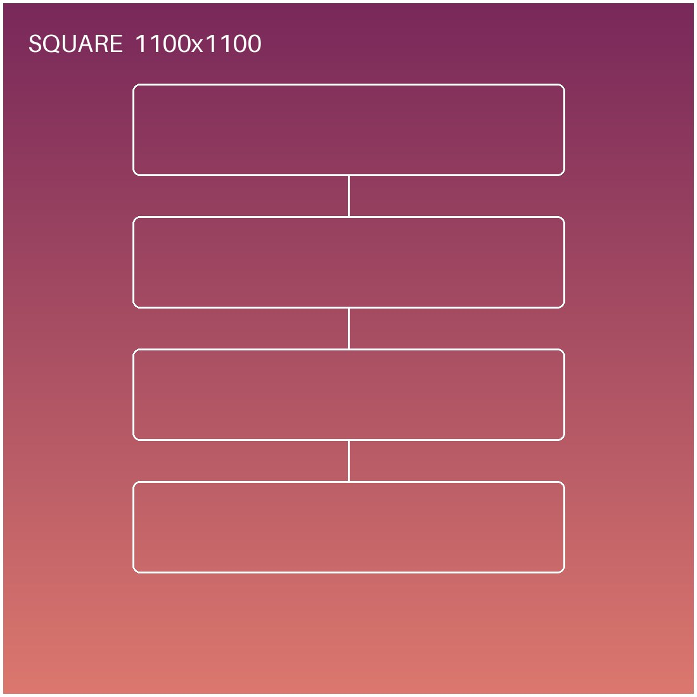
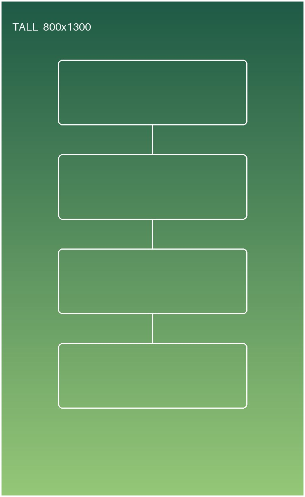

Articles can be long. Put the Markdown `more` comment (see the README) on its own line where you want
the front page and section lists to stop, and they will show a "continue →" link instead of the whole text.

<!--more-->


Text goes between images however you like.



Tall images are capped so they cannot take over the screen.



Small images are never blown up past their real size.

.")

## A heading

Normal paragraphs, [links](https://gohugo.io/), *italics* and **bold** all work.

> Quotes get a thin left rule, like the original theme.

### A code block

```cpp
// BEP 3 handshake: <pstrlen><pstr><reserved><info_hash><peer_id>
std::array<std::uint8_t, 68> handshake{};
```

| field | bytes |
| ----- | ----- |
| pstr  | 19    |
| info_hash | 20 |

*Placeholder — delete this file and add your own.*
